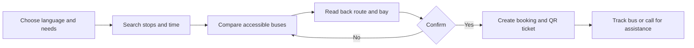
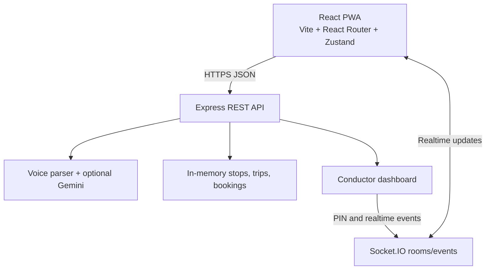

<div align="center">

# Hey Buss

**A voice-first, accessible bus journey experience for Kolkata**

[](./frontend)
[](./backend)
[](./frontend)
[](#accessibility)

<br />

[Open the Vercel project](https://vercel.com/bhavya-23-11-2006-shahs-projects/hey-buss)
·
[View on GitHub](https://github.com/Bhavya-23-11-2006-shah/hey_buss)
·
[Standard README](./README.md)

</div>

---

## Why Hey Buss matters

Public transport is most difficult when the interface assumes a passenger can see, hear, type, read quickly, and navigate uncertainty independently. Hey Buss brings the journey into one accessible experience:

- **Voice first:** Search and confirm journeys with spoken or typed input.
- **Disability led:** Wheelchair, blind, low-vision, deaf, elderly, and assistance needs are represented in the journey.
- **Clear by design:** Plain language, large controls, localized replies, captions, and keyboard support.
- **Conductor connected:** A second screen presents passenger assistance needs and live booking events.
- **Honest in demo mode:** Mock data is clearly separated from real backend availability.

> This project supports the intent of the Rights of Persons with Disabilities Act 2016 and Accessible India Campaign principles. It is a prototype, not a certified government service.

---

## Product experience

| Passenger | Conductor | Operator |
|---|---|---|
| Plan a route | Receive a booking | Change demo bus status |
| Filter by accessibility | View assistance needs | Mark a bus full or delayed |
| Use voice or buttons | Acknowledge a passenger | Reset demo scenarios |
| Receive QR ticket | See live route updates | Inspect backend health |

### Core journey



---

## Architecture



See [ARCHITECTURE.md](./ARCHITECTURE.md) for the detailed technical view.

---

## Accessibility

Hey Buss targets a strong implementation baseline, including:

- English, Hindi, and Bengali voice responses
- Screen-reader labels and live captions
- Light, dark, and high-contrast themes
- Text scaling and reduced-motion preferences
- Large touch targets and responsive navigation
- Visible focus states and text-only map fallback
- Voice, touch, and typed interaction alternatives
- SOS confirmation and cancellation behavior

The project aims to align with WCAG 2.2 AA and GIGW 3.0 principles. It should be described as **under evaluation**, not certified, until real-device and assistive-technology testing is completed.

---

## Judge demo: 90 seconds

```text
0-10 seconds  Open Hey Buss and select the Kolkata journey experience.
10-20 seconds Introduce the passenger needs and language choices.
20-35 seconds Search Howrah Station to Salt Lake Sector V.
35-50 seconds Compare the exact, earlier, and later accessible buses.
50-65 seconds Confirm the bus and show the wheelchair bay / route recap.
65-75 seconds Open the QR ticket and conductor screen.
75-85 seconds Trigger delay or full-bus demo behavior.
85-90 seconds Show the alternative route or reassignment and switch to high contrast.
```

---

## Local setup

### Backend

```bash
cd backend
npm install
cp .env.example .env
npm run dev
```

### Frontend

```bash
cd frontend
npm install
cp .env.example .env
npm run dev
```

Frontend: `http://localhost:5173`
Backend: `http://localhost:4000`

### Validation

```bash
cd frontend
npm run lint
npm run build

cd ../backend
npm test
npm run build
```

---

## Deployment

The frontend is built with Vite and is configured for Vercel. The backend is designed for Render with a blueprint in [render.yaml](./render.yaml).

Detailed instructions: [DEPLOY.md](./DEPLOY.md)

---

## Known demo limitations

- Timetable, route, and status data may be simulated.
- Mock SMS and conductor notifications do not contact real people.
- The SOS experience does not replace emergency number 112 or local emergency services.
- Backend state is in memory and restarts may erase demo bookings.
- Map rendering and speech APIs vary by browser and device.
- Live government-bus feeds, real identity verification, payments, and production SMS require authenticated provider integrations.

---

<div align="center">

**Hey Buss — clearer journeys, safer choices, and dignity at every stop.**

</div>
