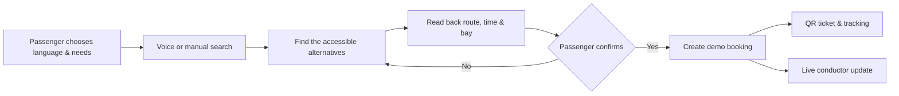
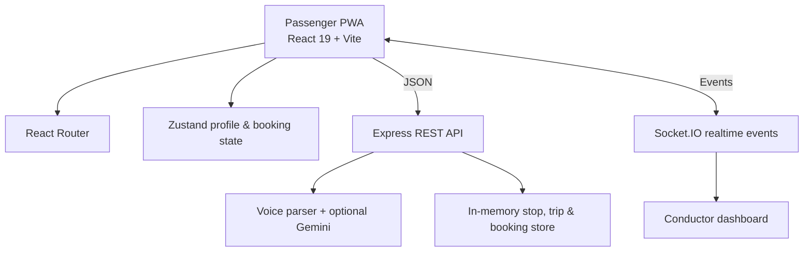

<div align="center">


# Hey Buss

### A bus that is ready for you.

**An accessible, voice-first transit companion for Kolkata**

[](https://hey-buss.vercel.app/)
[](./frontend)
[](./backend)
[](#accessibility)

<br />

**[Try Hey Buss](https://hey-buss.vercel.app/) · [How it works](#how-it-works) · [Architecture](./ARCHITECTURE.md) · [API](./contract.md)**

</div>

---

## Why Hey Buss exists

For many people, catching a bus is not simply about finding a route.

It can mean asking whether a ramp is available, finding out which stop is safest, hearing the right announcement, seeing the live route clearly, or trying to explain an assistance need without pressure.

**Hey Buss turns that uncertainty into a simple conversation.**

> Say where you are going. Choose the support you need. Confirm the bus. Know what happens next.

This project is a prototype for a more human public-transit experience—especially for passengers who are blind or visually impaired, deaf or hard of hearing, wheelchair users, elderly, neurodivergent, or travelling with an escort.

---

## The idea in one sentence

**Hey Buss is an accessibility-first bus journey assistant that lets passengers search, compare, book, track, and receive assistance through voice, touch, text, or their preferred language.**

It is designed around a simple promise:

<table>
  <tr>
    <td><strong>Understand me</strong><br />Use familiar words, clear questions, and no unnecessary complexity.</td>
    <td><strong>Protect me</strong><br />Read back the route, time, and wheelchair support before booking.</td>
    <td><strong>Include me</strong><br />Offer the same journey through voice, buttons, captions, and text.</td>
  </tr>
</table>

---

## What makes Hey Buss different

<table>
  <tr>
    <td width="50%">
      <h3>🗣️ It speaks, but it also listens</h3>
      The passenger can tap <strong>Talk</strong>, describe a journey, answer a follow-up question, or confirm a selection. Spoken replies are also shown as live captions.
    </td>
    <td width="50%">
      <h3>♿ Accessibility comes before the route</h3>
      A passenger can set their language and assistance needs, while the trip experience considers wheelchair bays, ramps, low-floor access, and other support.
    </td>
  </tr>
  <tr>
    <td>
      <h3>🚌 The app explains choices</h3>
      It can compare exact, earlier, and later buses instead of pretending that every requested time has a perfect match.
    </td>
    <td>
      <h3>🤝 The conductor stays connected</h3>
      A separate conductor view can receive booking events and passenger assistance notes in a live demo workflow.
    </td>
  </tr>
  <tr>
    <td>
      <h3>🌏 Kolkata feels familiar</h3>
      The experience uses real local stop names and routes, including Esplanade, Howrah, Sealdah, Tollygunge, Salt Lake Sector V, and Airport Gate 3.
    </td>
    <td>
      <h3>🎨 Every passenger can shape the display</h3>
      Light, dark, and high-contrast themes pair with text scaling and reduced-motion preferences.
    </td>
  </tr>
</table>

---

## How it works



### A typical journey

1. **Start the journey** — open Hey Buss and choose an English, Hindi, or Bengali experience.
2. **Describe the trip** — say or type where to board, where to go, and when to travel.
3. **Review real demo options** — compare exact, earlier, and later buses.
4. **Confirm safely** — the assistant recaps the route, departure time, and accessibility support.
5. **Receive the ticket** — keep a QR boarding pass and view trip status.
6. **Stay informed** — track the sample bus and open conductor or assistance tools.

The app is designed so the same journey remains possible for people who cannot use voice recognition, cannot hear spoken guidance, or need larger text and stronger contrast.

---

## The experience

| Passenger view | Designed for |
|---|---|
| Landing and onboarding | A first, clear introduction to the journey |
| Home and voice assistant | Fast trip requests and concise spoken replies |
| Accessible booking | Three-step route, bus, and confirmation flow |
| Tracking | A live-style route map with a text-only alternative |
| Tickets | QR boarding pass, booking status, and 30-second undo |
| Help | Type-to-speak phrases and accessibility guidance |
| Profile and display settings | Name, needs, language, themes, and text size |

### For conductors

The conductor screen provides a demonstration workflow for receiving a passenger booking and recording assistance states such as:

- `AT_STOP`
- `BUS_HERE`
- `ASSISTING`
- `TAKE_NEXT`

The sample interface shows how passenger needs and route details could be presented to staff while preserving clear, visible, and urgent SOS messaging.

---

## Built with



| Layer | Technology |
|---|---|
| Frontend | React 19, Vite, TypeScript, React Router, Zustand |
| PWA | Installable web app, offline assets, responsive layout |
| Backend | Node.js, Express, TypeScript, Zod |
| Real-time | Socket.IO |
| Voice | Browser speech APIs with optional Gemini understanding |
| UI support | Leaflet / MapLibre, QR generation, system themes |
| Hosting | Vercel frontend and Render backend blueprint |

---

## Accessibility

Hey Buss aims to follow the principles of **WCAG 2.2 AA** and **GIGW 3.0**. It is not a certified accessibility claim.

The project currently includes or targets:

- English, Hindi, and Bengali interfaces
- Voice search and visible live captions
- Light, dark, and high-contrast themes
- Text scaling and reduced-motion settings
- Large controls and responsive mobile navigation
- Keyboard focus styles and screen-reader labels
- Text alternatives for visual tracking
- Typed, touch, and voice paths for key actions

Before real-world use, this experience needs testing with TalkBack, VoiceOver, desktop and mobile browsers, Firefox fallback, 320px layouts, and 200% text.

---

## 90-second story

```text
0:00  Open Hey Buss and introduce the everyday problem.
0:10  Choose a language and accessibility needs.
0:20  Say or type: “Esplanade to Salt Lake Sector V at 9 AM.”
0:35  Compare exact, earlier, and later buses.
0:50  Read back the route, departure time, ramp, and wheelchair bay.
1:05  Confirm and open the QR boarding pass.
1:15  Open the conductor view or trigger a delay/full-bus demo.
1:30  Show the accessible alternative and finish in high contrast.
```

---

## Live demo

<div align="center">

[](https://hey-buss.vercel.app/)

</div>

---

## Honest demo boundaries

Hey Buss is a prototype and should be judged for its product idea, accessibility intent, and interaction quality—not as a live government transport service.

- Timetables and bus positions are demonstration data.
- Mock SMS and conductor notifications do not contact real people.
- An SOS flow does not replace calling **112** or local emergency services.
- Backend bookings stay in memory and may reset when the server restarts.
- Voice accuracy depends on the browser, device, network, and speech service.
- Live government feeds, identity verification, payments, and real dispatch require authorized integrations.

---

## Repository

| Area | Open |
|---|---|
| Frontend | [frontend/](./frontend) |
| Backend | [backend/](./backend) |
| Architecture | [ARCHITECTURE.md](./ARCHITECTURE.md) |
| Deployment | [DEPLOY.md](./DEPLOY.md) |
| API contract | [contract.md](./contract.md) |

### Development checks

```bash
cd frontend
npm run lint
npm run build

cd ../backend
npm test
npm run build
```

---

<div align="center">

## Hey Buss asks one simple question

### “How would you like to travel today?”

And then it works to make the answer feel possible.

<br />

**A clearer journey is a kinder journey.**

</div>
