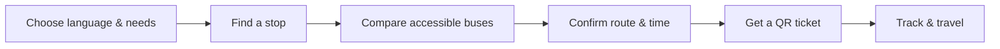
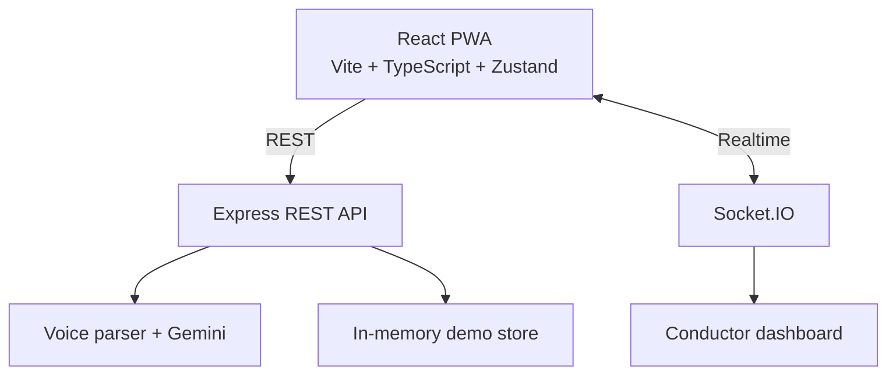

<div align="center">


# 🚌 Hey Buss

### A bus that is ready for you.

**A voice-first, accessibility-led transit experience for Kolkata**

[](https://hey-buss.vercel.app/)
[](./frontend)
[](./backend)
[](#accessibility)

<br />

[Explore the app](https://hey-buss.vercel.app/)
·
[Architecture](./ARCHITECTURE.md)
·
[Deployment](./DEPLOY.md)
·
[API contract](./contract.md)

</div>

---

## ✨ The idea

**Hey Buss** makes public-bus journeys feel less uncertain for passengers with disabilities.

It combines voice guidance, clear trip choices, accessible booking details, live conductor tools, and multiple ways to interact—so a journey can begin with speech, touch, typing, or assistive technology.

> Built for blind, low-vision, deaf, wheelchair, elderly, and cognitive-accessibility needs—not added as an afterthought.

---

## 💛 What you can do

<table>
  <tr>
    <td width="33%" valign="top">
      <h3>🗣️ Talk</h3>
      Search in English, Hindi, or Bengali and receive a spoken reply with clear captions.
    </td>
    <td width="33%" valign="top">
      <h3>♿ Choose access</h3>
      Compare buses by ramp, wheelchair bay, low floor, audio, visual display, and priority seating.
    </td>
    <td width="33%" valign="top">
      <h3>🎫 Travel clearly</h3>
      Confirm a trip, view a QR ticket, track the bus, and manage the booking.
    </td>
  </tr>
</table>

<br />

- Voice-first search and confirmation
- Earlier, exact, and later accessible alternatives
- Route, departure time, and wheelchair-bay recap
- Light, dark, and high-contrast themes
- Large-text and reduced-motion controls
- Conductor dashboard for passenger assistance
- Demo delay, full-bus, and reassignment flows
- QR tickets, sharing, and text-only tracking

---

## 🧭 One journey, made simple



---

## 🏗️ Under the hood



| Area | Technology |
|---|---|
| Frontend | React 19, Vite, TypeScript, React Router, Zustand, PWA |
| Backend | Express, Socket.IO, Zod, TypeScript |
| Voice | Web Speech APIs plus optional Gemini parsing |
| Mapping | Leaflet / MapLibre with text-only fallback |
| Deployment | Vercel frontend, Render backend |

---

## 🔐 Environment

| Variable | Where | Purpose |
|---|---|---|
| `VITE_API_URL` | Frontend | Render or local backend URL |
| `GEMINI_API_KEY` | Backend | Optional Gemini API key |
| `GEMINI_MODEL` | Backend | Primary voice model |
| `GEMINI_FALLBACK_MODEL` | Backend | Fallback voice model |
| `CONDUCTOR_PIN` | Backend | Conductor dashboard PIN |
| `FRONTEND_ORIGIN` | Backend | Allowed frontend CORS origin |

> Keep API keys and PINs in environment variables, never in source code.

---

## 🎬 90-second demo

1. Open the app and choose a language and passenger needs.
2. Search from **Howrah Station** to **Salt Lake Sector V**.
3. Compare the exact, earlier, and later accessible buses.
4. Confirm the route, time, and wheelchair-bay count.
5. Open the QR ticket and conductor dashboard.
6. Trigger a demo delay or full-bus scenario.
7. Show the replacement bus or accessible alternative.
8. Finish in high contrast or with the text-only tracking view.

---

## ♿ Accessibility

Hey Buss aims to implement **WCAG 2.2 AA** and **GIGW 3.0** principles.

This is a working prototype, not a certification or a production government service. Real TalkBack, VoiceOver, Firefox fallback, keyboard, 320px reflow, and 200% text testing are still required before operational claims.

### Honest limitations

- Trip data is demo data, not a live government timetable.
- SOS and SMS actions are demonstrations unless real providers are integrated.
- Backend bookings are in memory and may reset after restart.
- Voice recognition and speech quality vary by browser and device.
- Never rely on this prototype for real emergency response.

---

## 🧪 Development checks

```bash
# Frontend
cd frontend
npm run lint
npm run build

# Backend
cd ../backend
npm test
npm run build
```

---

## 📚 Project docs

| Document | Purpose |
|---|---|
| [Frontend README](./frontend/README.md) | React PWA setup and interface |
| [Backend README](./backend/README.md) | API, voice, and Socket.IO server |
| [Architecture](./ARCHITECTURE.md) | System design and data flows |
| [Deployment](./DEPLOY.md) | Vercel and Render setup |
| [API contract](./contract.md) | Request and response shapes |

---

<div align="center">

### Made with purpose, clarity, and a little Kolkata energy. 🚌💜

**Hey Buss — a clearer journey is a kinder journey.**

</div>
